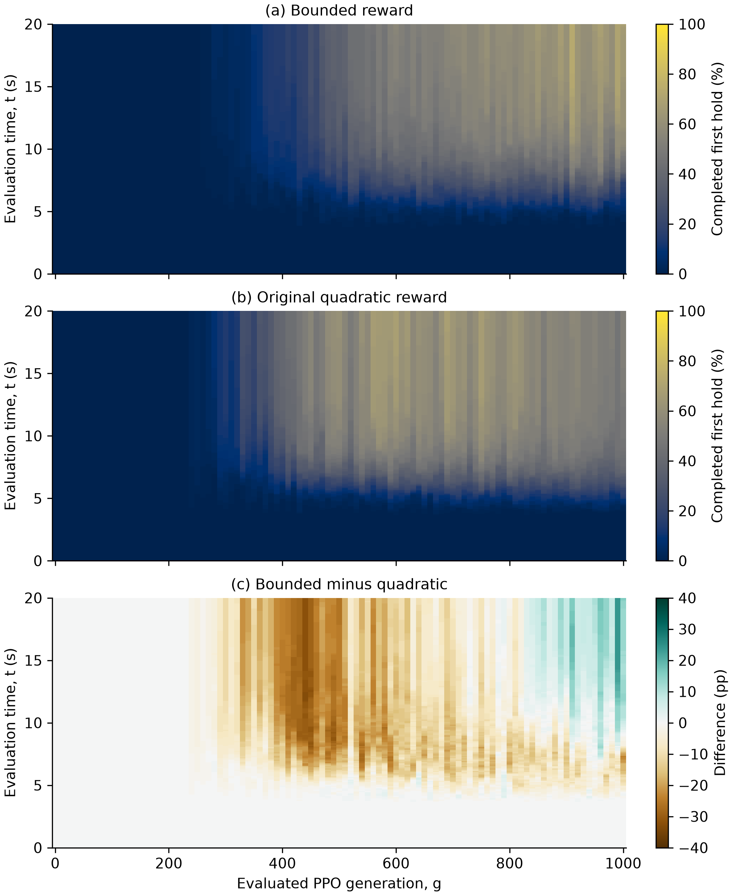
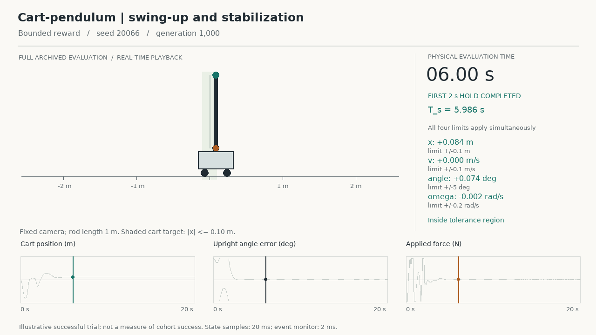

# Cumulative Stabilization Probabilities During PPO Learning

**A Paired Reward Study for Cart-Pendulum Swing-Up**  
Shaikhislam Askanbay · Research preprint, version 1.1

This repository contains the nonlinear cart-pendulum simulator, frozen learning
configurations, audited event data, analysis code, and research preprint.
The research asks how often independently trained controllers complete a
sustained stabilization interval, as a function of training progress and
physical time within an evaluation:

$$H(g,t)=P(T_s(g)\le t).$$

A generation is one 1,000-interaction PPO rollout/update cycle per controller
(ten optimization epochs). The same 100 independent training seeds are paired
across two rewards and evaluated at generations 0, 10, ..., 1,000. Evaluation
starts downward, lasts 20 s, and requires a simultaneous 2 s hold within
|x| <= 0.1 m, |v| <= 0.1 m/s, upright-angle error <= 5 degrees, and
|angular velocity| <= 0.2 rad/s. First completion is cumulative; later exits
are recorded separately. Failed/censored trials stay in the denominator.

## Read the study

- [Research preprint (PDF)](paper/manuscript.pdf)
- [Editable manuscript](paper/manuscript.md)
- [Complete reproduction instructions and data dictionary](REPRODUCTION.md)
- [Nonlinear physics derivation](source/PHYSICS.md)



## Main observations

At the fixed final generation, success by 20 s was **68/100 bounded** versus
**52/100 quadratic**, an observed paired difference of **16 percentage points**.
The declared conservative 95% paired interval was -3.461 to +34.184 points;
the separate exact McNemar test gave p=0.022629. These are different statistical
procedures, and both results are retained. The interval includes zero.

Quadratic reached substantial success earlier during learning, then regressed.
At the final generation it produced more completions by 5 s, while bounded
produced more by 20 s. Neither reward uniformly dominated the full measured
surface. The comparison was designed after the bounded arm's results were
known and is reported as a follow-up, not an independent confirmatory trial.
The implemented PPO variant uses separate actor/critic gradient clipping.

## Reproduce the results without training

Use Python 3.12. From the repository root:

```console
python -m pip install -r requirements-analysis.txt
python reproduce_analysis.py --output reproduced
```

The output folder must be new. The script verifies input checksums and
reproduces both cumulative surfaces, reported arm statistics, the paired
endpoint, and descriptive transitions. It does not train, load policies, or
require Torch. Generated comparison figures use the same data with a wide
layout; the paper includes a portrait layout.

To run the supplied physics, environment, stabilization, and analysis checks:

```console
python -m pip install -r requirements-test.txt
cd source
python -m pytest -q
```

For optional full training reruns, see [REPRODUCTION.md](REPRODUCTION.md).
Historical entry points are retained in the source snapshot; they are not
additional independent replications and need not be executed for analysis.

## One complete successful evaluation

[Watch or download the full simulation (MP4)](media/successful_simulation.mp4)



The clip shows the full archived 0–20 s evaluation of seed **20066**, bounded
reward, generation **1,000**. Its first required hold completed at **5.986 s**;
no subsequent exit was observed before 20 s. One trial was selected uniformly
from all 120 successful final arm/seed evaluations, without redraw or screening.
This success-conditioned example is illustrative, not a cohort success estimate.
Selection details, the original trajectory subset, and the renderer are in
[media/](media/README.md). No new simulation was run to make the video.

## Repository contents and availability

| Folder / file | Purpose |
| --- | --- |
| `data/` | All 10,100 per-seed events per arm, surfaces, summaries and validation reports |
| `source/` | Simulator, PPO implementation snapshot, analysis, configurations and tests |
| `paper/` | Revised preprint, editable text, references, equations, figures and PDF renderer |
| `media/` | Full example video, selected trace, selection record and renderer |
| `reproduce_analysis.py` | Recalculate published event-data results without training |
| `CHECKSUMS.json` | File integrity manifest for this prepared release |

Full model/optimizer/recovery archives and all raw control-step traces are
preserved separately and are not included, except for the one video trajectory.
This folder supports reproduction of the paper's event-data results; it does
not contain every training artifact. No real-hardware or perturbation-robustness
claim is made.

## License and citation

The original software is available under the [MIT License](LICENSE),
copyright (c) 2026 Shaikhislam Askanbay. Keep the existing
[Stable-Baselines3 notice](source/third_party/SB3_LICENSE.txt) with its covered
third-party code. [LICENSING.md](LICENSING.md) defines the scope; the paper,
research data and videos still have separate, pending license choices.

Author and software citation details are in [CITATION.cff](CITATION.cff).
No DOI is supplied until an actual deposit has been published.
