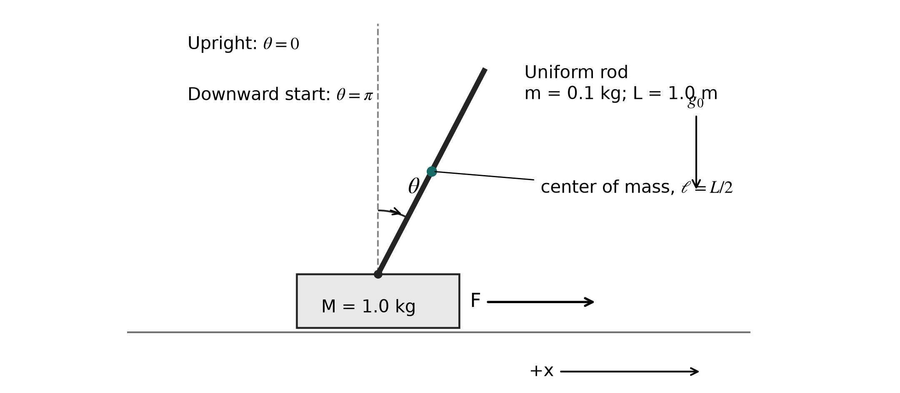
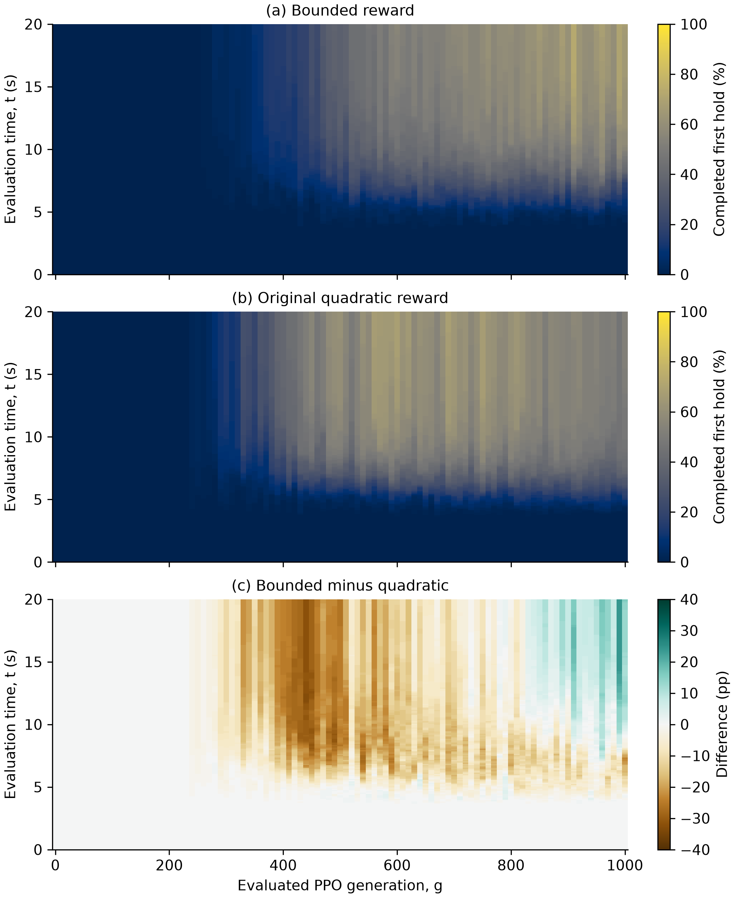
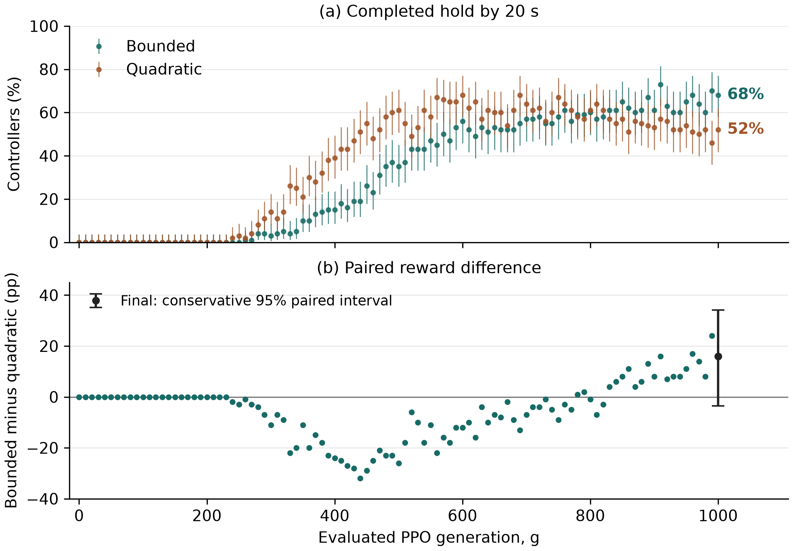
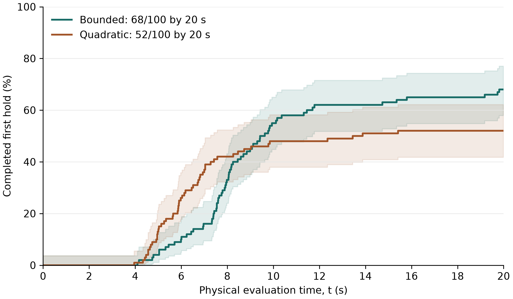

# Cumulative Stabilization Probabilities During PPO Learning

### A Paired Reward Study for Cart-Pendulum Swing-Up

**Shaikhislam Askanbay**

Research preprint · Version 1.1 · 30 October 2026

## Abstract

Reinforcement-learning controllers for pendulum swing-up can differ both in when successful behavior emerges during training and in how quickly a trained policy stabilizes the physical system. A single final return or success percentage does not separate these effects. This simulation study measures H(g,t), the probability that a controller has completed its first sustained stabilization interval by evaluation time t after training generation g. Two reward formulations are compared using 100 paired training seeds, 1,000 PPO rollout/update cycles per controller, and full 20 s evaluations every ten generations. A fully nonlinear uniform-rod cart-pendulum model is integrated using fourth-order Runge-Kutta at 2 ms. Success requires a simultaneous two-second hold within specified position, velocity, upright-angle, and angular-velocity tolerances. The original quadratic reward reached a measured 50% success rate earlier in training, at generation 440 rather than 570, but its success rate subsequently regressed. At generation 1,000, the bounded reward achieved 68/100 successes by 20 s, versus 52/100 for the quadratic reward. The observed paired difference was 16 percentage points; a prespecified conservative 95% interval was -3.5 to 34.2 points, and the two-sided exact McNemar test gave p=0.0226. Final cumulative curves crossed: quadratic produced more completions by 5 s, while bounded produced more by 20 s. These observations support evaluating the complete learning-time surface and retaining failures and regressions. They do not establish an optimal reward or robust physical control. The comparison is a follow-up designed after the bounded arm was observed; its inference is interpreted accordingly.

**Keywords:** reinforcement learning; proximal policy optimization; cart-pendulum; swing-up; sustained stabilization; time to event; reproducibility.

## 1. Introduction

The cart-pendulum swing-up problem combines a nonlinear maneuver with stabilization near an unstable equilibrium. A horizontal cart force must transfer energy to a pendulum initially hanging downward and then regulate the cart and rod near a centered upright state. Standard nonlinear-control treatments distinguish this full maneuver from local balancing [1]. This distinction matters for reinforcement learning: an upright-angle termination rule suitable for a balancing benchmark would prevent the swing-up behavior studied here.

There are two relevant clocks. The first measures learning progress: how much interaction and optimization a controller has received. The second measures physical time during an evaluation episode. A controller may become successful early in training but later regress; another may improve more slowly yet achieve a higher final success probability. At a fixed training checkpoint, one policy may stabilize quickly in a small subset of runs while another stabilizes a larger subset later. A scalar endpoint cannot describe all of these situations.

This study follows a fixed cohort of independently initialized controllers and records the first completion of a sustained stabilization interval at each evaluated checkpoint. The resulting empirical cumulative probability surface has training generation on its horizontal axis, physical evaluation time on its vertical axis, and percentage of successful controllers as color. The target is a distribution over training randomness under fixed deterministic evaluation conditions. It is not the probability of surviving random disturbances.

PPO provides a practical policy-gradient framework in which a collected batch can be reused for multiple optimization epochs [2]. Its empirical behavior nevertheless depends on the implementation, reward, and experimental protocol. Stable-Baselines3 supplies the underlying software framework used here [3]. Prior work emphasizes reproducible experimental procedures [4] and uncertainty in finite-run deep-RL evaluations [5]. Those concerns motivate explicit seed-level outcomes, preserved configurations, and uncertainty statements in this study.

The study asks how cumulative first-hold probability evolves with both clocks, and how it changes between two reward forms with the remaining scientific settings fixed.

## 2. Nonlinear physical system

### 2.1 Assumptions and angle convention

The cart has mass M=1.0 kg. The pendulum is a planar, uniform, slender rigid rod of mass m=0.1 kg and total length L=1.0 m. Uniform mass distribution is an explicit modeling assumption: mass and total length alone would not determine the center of mass or rotational inertia. The center-of-mass distance is ell=L/2=0.5 m. The center-of-mass inertia and pivot inertia are I_c=mL²/12 and J=I_c+m ell²=mL²/3, respectively.

The state is s=(x,v,theta,omega), where v is cart velocity and omega is rod angular velocity. Positive x points right. Theta is measured clockwise from the upward vertical, so the rod center of mass has coordinates:

$$
X_c=x+\ell\sin\theta,\qquad Y_c=\ell\cos\theta.
$$

The initial state is exactly (0,0,pi,0), and the desired equilibrium is (0,0,0,0), with upright angles understood modulo 2 pi. The physical angle remains unwrapped to permit complete rotations. Wrapped upright error is used only where periodicity is required, including the success criterion. Force is limited to -10 to +10 N. Baseline cart and pivot damping are zero. Collisions, actuator dynamics, measurement noise, and a physical end-of-track mechanism are absent.

| Quantity | Value |
| --- | ---: |
| Cart mass M | 1.0 kg |
| Rod mass m | 0.1 kg |
| Total rod length L | 1.0 m |
| Center-of-mass distance ell | 0.5 m |
| Center-of-mass inertia I_c | 0.0083333333 kg m² |
| Pivot inertia J | 0.0333333333 kg m² |
| Gravity g_0 | 9.81 m/s² |
| Maximum force magnitude | 10 N |
| Control interval / integration substep | 0.02 s / 0.002 s |

### 2.2 Equations of motion

Using the center-of-mass coordinates above, the kinetic and potential energies are:

$$
K=\frac{1}{2}(M+m)v^2+m\ell\cos\theta\,v\omega+\frac{1}{2}J\omega^2.
$$

$$
V=mg_0\ell(1+\cos\theta).
$$

The potential-energy zero is the downward configuration. Applying the Euler-Lagrange equations to K-V, with generalized forces F-bv and -c omega, gives:

$$
(M+m)\ddot{x}+m\ell\cos\theta\,\ddot{\theta}-m\ell\sin\theta\,\omega^2=F-bv.
$$

$$
m\ell\cos\theta\,\ddot{x}+J\ddot{\theta}-mg_0\ell\sin\theta=-c\omega.
$$

The damping parameters b and c are included for validation but are zero in both learning studies. Define A=M+m, B=m ell cos(theta), r_x=F-bv+m ell sin(theta) omega², and r_theta=m g_0 ell sin(theta)-c omega. The nonlinear accelerations are then:

$$
D=AJ-B^2,\qquad \ddot{x}=\frac{Jr_x-Br_\theta}{D},\qquad \ddot{\theta}=\frac{Ar_\theta-Br_x}{D}.
$$

For positive cart and rod masses, D is positive. In particular, D is at least (M+m)I_c+Mm ell², so the mass matrix is nonsingular for this model. No small-angle approximation is used in the simulation. As a sign check, a positive force at exact upright initially accelerates the cart right and produces negative angular acceleration of the rod under the chosen convention.

The total energy E=K+V and horizontal momentum p_x obey:

$$
\dot E=Fv-bv^2-c\omega^2,\qquad p_x=(M+m)v+m\ell\cos\theta\,\omega.
$$

$$
\dot p_x=F-bv.
$$

Consequently, energy and horizontal momentum are conserved in the unforced, frictionless system. The energy difference between stationary downward and upright configurations is 2m g_0 ell=0.981 J. Energy conservation is a necessary numerical check here, not sufficient evidence that every aspect of the model or environment is correct.

### 2.3 Numerical integration and validation

The simulator uses float64 physics, classical fourth-order Runge-Kutta integration, and a force held constant for each 0.02 s control interval. Each interval contains ten 0.002 s integration substeps. RK4 is not exactly energy preserving; validation therefore checks finite-time conservation errors and convergence rather than asserting exact conservation.

Four unforced, frictionless trajectories were integrated for 60 s: oscillation, rotation, coupled cart/rod motion, and release close to upright. Their maximum absolute energy drifts ranged from 1.18e-11 to 3.94e-10 J, below the fixed 1e-6 J acceptance threshold. Maximum momentum drift was approximately 3.87e-10 kg m/s, below its 1e-7 tolerance. These results apply to the tested states, parameters, speeds, and durations.

An independent matrix-form right-hand side with SciPy DOP853 provided a forced-motion reference. At the study substep, the largest component discrepancy over the two-second reference test was approximately 4.63e-10 in the corresponding raw state component. Step-halving error ratios of 16.01 and 15.87 were consistent with fourth-order convergence. Applied-work and damped-dissipation balance residuals were below 4.2e-11 J. The supplemental validation report preserves the separate units and tolerance definitions; a Euclidean norm mixing raw state components was used only as a convergence diagnostic.

Additional checks covered equilibrium signs, reflection symmetry, action validity, Gymnasium reset and truncation behavior [9], and sustained-hold measurement. An uncontrolled exact downward state remained a negative control. An exact upright state completed the hold at 2 s. Synthetic entry and short-violation cases checked hold timing and resetting. A separate energy-based swing-up/local-stabilization reference achieved the full physical task at 6.994 s in a recorded feasibility check. That reference was not trained, was not an additional replication, and is not treated as a statistically evaluated third controller family.

## 3. Measurement target and experimental design

### 3.1 First completed sustained stabilization

Define the tolerance region R by simultaneous conditions:

$$
|x|\leq0.1\;\mathrm{m},\quad |v|\leq0.1\;\mathrm{m/s},\quad |\operatorname{wrap}(\theta)|\leq5^\circ,\quad |\omega|\leq0.2\;\mathrm{rad/s}.
$$

The required hold is tau=2.0 s. Conceptually, the first completion time is:

$$
T_s=\inf\{t\geq\tau:\ s(u)\in R\ \mathrm{for\ all}\ u\in[t-\tau,t]\}.
$$

The implementation observes every integration substep. It starts a residence timer at the first in-region sample, resets that timer on any sampled violation, and records the first sample at which the residence duration reaches two seconds. This is a discrete 2 ms operational definition approximating the continuous expression. Neither the 2 ms samples nor the coarser stored traces prove continuous residence between observations. The success rule was fixed independently of the training reward.

Success means the required interval has been completed at least once. A later exit is recorded separately and does not remove the first event. Evaluation continues for the full 20 s even after success. Thus cumulative success must not be confused with the instantaneous fraction currently inside R or with a guarantee of indefinite future stability.

### 3.2 Two clocks and the cumulative surface

One generation g is one PPO rollout/update cycle per controller: 1,000 new environment interactions followed by ten optimization epochs. A generation is not an evolutionary population replacement, a single optimizer step, or one physical evaluation second. With minibatches of 250, each generation contains 40 minibatch optimizer steps. Training progress in interactions per controller is e(g)=1000g.

The second clock, t, is simulated physical time during evaluation. For a reward formulation r and checkpoint g, the population target and estimator are:

$$
H_r(g,t)=P\{T_{s,r}(g)\leq t\},\qquad \widehat{H}_r(g,t)=\frac{1}{100}\sum_{i=1}^{100}{\bf1}\{T_{s,r,i}(g)\leq t\}.
$$

The probability is over training initialization and sampling randomness under the specified recipe. Evaluation itself uses deterministic actions and an exact fixed start. Repeating the same deterministic controller/start combination would not supply another independent training replication.

For each fixed g, H is nondecreasing in t. There is no corresponding monotonicity requirement in g, because a new policy is learned after every update. All first-event times and failures are retained at every checkpoint, including decreases in success rate. The same cohort is followed longitudinally; cells across time and generation are correlated.

### 3.3 Cohorts, pairing, and follow-up status

Each arm contains 100 controllers with training seeds 20000 through 20099. Each controller has private policy and value parameters, optimizer state, experience, random streams, and observation-normalization statistics. The bounded-reward cohort was completed first. The quadratic counterpart was then trained from generation zero with the same seed list and scientific settings, reusing the completed bounded arm as its reference. All 100 starting pairs were checked for identical weights, optimizer state, random streams, and normalization.

The quadratic design and primary endpoint were fixed before its training, but after the bounded results were available. This is a paired follow-up, not a simultaneous randomized trial, an external preregistration, or an independent confirmatory replication. The local dated protocols and hashes document the workflow. Nominal inferential statements must be read in this follow-up context, rather than as a guarantee against all effects of prior study or analysis selection.

Each controller completed G=1000 generations, totaling one million retained training interactions. Each arm therefore contains 100 million retained interactions. Checkpoints g=0,10,...,1000 provide 101 evaluations per controller and 10,100 complete evaluation episodes per arm. Each episode has 1,000 control intervals, so evaluation adds 10.1 million interactions per arm. Earlier exploratory work and technical repeat branches are separate from these 100 paired replications and are not pooled with them. The cohort size was fixed as a research budget rather than derived from a prospective statistical power calculation; no power guarantee is claimed.

### 3.4 PPO implementation and episode semantics

Both arms use the same declared PPO variant: actor and critic gradients are clipped separately at norm 0.5 before a shared Adam optimizer step. This differs from clipping a single combined actor/critic gradient vector. The actor group contains the policy network, action head, and learned log standard deviation; the critic group contains its separate value network and value head. The feature extractor has no trainable parameters. This implementation choice was fixed before the bounded study and is not interpreted as a finding about unchanged default PPO implementations.

| Setting | Value |
| --- | --- |
| Networks | Separate 64 x 64 Tanh actor and critic |
| PPO rollout / minibatch / epochs | 1000 / 250 / 10 |
| Learning rate | Constant 0.0003 |
| Discount gamma / GAE lambda | 0.99 / 0.95 |
| PPO clipping parameter | 0.2 |
| Entropy coefficient / value-loss coefficient | 0 / 0.5 |
| Gradient norm bound | 0.5 separately for actor and critic |
| Adam betas / epsilon / weight decay | (0.9, 0.999) / 1e-5 / 0 |
| Initial Gaussian action standard deviation | 1.0, subsequently learned |
| Observation / reward normalization | Private running observation statistics / none |

The policy input is (x,v,sin(theta),cos(theta),omega/5), with position and velocity divided by their 1 m and 1 m/s scales. These encoded observations and policy computations are float32; the physical integrator remains float64. Private running mean and variance normalize observations, using epsilon=1e-8 and clipping normalized inputs to [-10,10]. Statistics continue updating during training and are frozen at evaluation with the matching saved policy. No reward normalization or additional reward multiplier is used.

The action is a normalized force command clipped to [-1,1] and mapped to [-10,10] N. Training uses Gaussian sampling; evaluation uses the deterministic policy output. Both reward forms share a training-only terminal failure when the cart reaches or exceeds |x|=3 m at a control endpoint, with an additional cost of 10 and a reset. Other training episodes are truncated after 20 s. Evaluation has no cart boundary and no angle-based termination. A failure during training is therefore not an early censored evaluation episode.

The training boundary is an engineering choice shared by the two arms, not a simulated hard rail with impacts. The resulting findings are specific to that training distribution. They do not establish how either reward would behave with unbounded training, a different failure cost, actuator lag, or a real finite track.

### 3.5 Reward formulations

Let u(theta)=(1+cos(theta))/2 and define the saturation gate:

$$
A(z;s)=\frac{1}{1+(z/s)^2}.
$$

The scales for x, v, omega, and F are 1 m, 1 m/s, 5 rad/s, and 10 N. Their penalty weights are 0.1, 0.01, 0.01, and 0.001. Rewards are evaluated at the resulting state with the force applied over that control interval. The original quadratic formulation is:

$$
r_Q=u(\theta)-0.1(x/1)^2-0.01(v/1)^2-0.01(\omega/5)^2-0.001(F/10)^2.
$$

For the bounded form, abbreviate A_x=A(x;1), A_v=A(v;1), A_w=A(omega;5), and A_F=A(F;10). Then:

$$
r_B=u(\theta)A_x\frac{1+A_v}{2}\frac{1+A_w}{2}-0.1(1-A_x)-0.01(1-A_v)-0.01(1-A_w)-0.001(1-A_F).
$$

The numerical denominators denote the corresponding SI scales. The bounded nonterminal expression lies within the conservative range [-0.121,1]; the shared terminal boundary cost is additional. The comparison changes both upright-benefit gating and penalty saturation. It cannot isolate either ingredient, identify an optimal penalty, or establish that boundedness alone explains a result. The label “original quadratic” refers to this project's reference formula, not a universal standard reward.

Neither reward explicitly pays a bonus for completing the measured two-second hold. Both optimize discounted sums of instantaneous terms rather than H directly. Returns computed under different formulas are consequently not a common performance score. The physical first-event definition, fixed time budgets, and seed-level outcomes provide the common comparison.

## 4. Statistical analysis

### 4.1 Administrative censoring and pointwise uncertainty

Every valid controller is evaluated for the same 20 s horizon. A controller without a first event is right-censored at 20 s, not classified as incapable forever and not assigned an observed completion at 20 s. For the storage and computation of cumulative counts, an infinity sentinel means “not observed within follow-up”; it is not an estimated infinite physical completion time. Missing or corrupted records would be integrity failures, not valid censored controllers. The audit found complete records for the fixed cohorts.

With common complete follow-up through 20 s, direct event counts estimate H(g,t) for t within that horizon. There is no need to infer unobserved event times or remove failures from the denominator. Pointwise 95% Clopper-Pearson intervals [6] are reported for each arm. They describe uncertainty across the training-seed sampling model at one cell, not simultaneous coverage of an entire heatmap. The 20,301 cells per arm do not create 20,301 independent experiments.

### 4.2 Declared paired final endpoint

The primary endpoint was the bounded-minus-quadratic difference at g=1000 and t=20 s. Let B_i and Q_i indicate success for paired seed i. Define p10=P(B=1,Q=0) and p01=P(B=0,Q=1). Then:

$$
\Delta=E(B_i-Q_i)=p_{10}-p_{01},\qquad \widehat{\Delta}=\frac{n_{10}-n_{01}}{100}.
$$

The declared conservative 95% interval uses two 97.5% two-sided Clopper-Pearson intervals for p10 and p01. A union bound gives at least 95% joint coverage under the sampling model without assuming independence of these two counts. Subtracting opposite endpoints gives:

$$
\Delta\in[L_{10}-U_{01},\ U_{10}-L_{01}].
$$

A two-sided exact McNemar calculation also tests equal directions among discordant pairs [7,8]. It is implemented as an exact binomial test with success probability 0.5, conditioning on n10+n01. Only the final declared endpoint receives this primary paired test. Intermediate surface differences, time summaries, and later exits are descriptive. No favorable checkpoint or heatmap cell is selected for replacement inference.

The conservative difference interval and exact conditional test are different procedures and are not an inversion pair. Their zero-exclusion and rejection decisions can therefore differ. Both are reported, rather than replacing the interval after seeing the results. In addition, because the follow-up reuses an already observed reference arm, nominal confidence and p-values are interpreted as follow-up evidence with study-selection limitations.

### 4.3 Timing summaries and supplementary descriptive analysis

The final empirical cumulative curves are displayed as exact steps at recorded first-event times. A failure-inclusive timing summary is the capped mean, or restricted mean time without a completed event through the fixed horizon:

$$
\overline{T}_{20}=\frac{1}{100}\sum_{i=1}^{100}\min(T_{s,i},20)=\int_0^{20}[1-\widehat{H}(1000,t)]\,dt.
$$

For a no-event observation, the capped contribution is known to be 20 s even though its true eventual completion time is unknown. Lower capped time combines earlier completion and fewer failures within the specified horizon. It is not the uncensored mean of eventual stabilization time. The first time the empirical H reaches 0.5 is also reported, alongside a clearly labeled median conditional on observed success.

For interpretation of learning regressions, two additional summaries were computed after collection: the first measured checkpoint reaching 50/100 successes by 20 s, and within-arm success/failure transitions between G=600 and G=1000. These are explicitly post hoc descriptive summaries. No new hypothesis tests or inferential intervals were attached to them.

## 5. Results

### 5.1 The complete cumulative probability surfaces

Both arms had zero observed events at G=0 and G=100. The first positive evaluated checkpoints were G=240 for quadratic and G=260 for bounded (Figure 2). These are observed columns, not exact learning-onset times; intermediate policies remain unmeasured.

During much of intermediate training, the quadratic arm had more controllers completing a hold by 20 s. At G=300 the counts were 14 versus 3, and at G=500 they were 61 versus 35. The ordering at G=1000 reversed to 52 versus 68. This is direct evidence that a ranking based on a single selected generation would incompletely describe this dataset.

| Generation | Bounded by 20 s | Quadratic by 20 s | Bounded minus quadratic |
| --- | ---: | ---: | ---: |
| 0 | 0/100 | 0/100 | 0 pp |
| 100 | 0/100 | 0/100 | 0 pp |
| 300 | 3/100 | 14/100 | -11 pp |
| 500 | 35/100 | 61/100 | -26 pp |
| 600 | 56/100 | 68/100 | -12 pp |
| 750 | 58/100 | 67/100 | -9 pp |
| 900 | 61/100 | 53/100 | +8 pp |
| 1000 | 68/100 | 52/100 | +16 pp |

The first measured checkpoint reaching at least 50/100 successes by 20 s was G=440 for quadratic and G=570 for bounded. This post hoc descriptive threshold concerns attainment at one observed checkpoint, not sustained superiority or a population sample-complexity guarantee. No interpolation is used to assign an attainment generation between saved policies.

### 5.2 Final paired endpoint and uncertainty

At G=1000, 68 bounded-reward controllers and 52 quadratic-reward controllers completed the qualifying hold by 20 s (Figure 3). Their marginal pointwise 95% intervals were 57.9-77.0% and 41.8-62.1%, respectively. The paired outcomes were:

| Outcome for the same training seed | Count |
| --- | ---: |
| Both succeed | 38 |
| Bounded only succeeds | 30 |
| Quadratic only succeeds | 14 |
| Neither succeeds | 18 |
| Total paired seeds | 100 |

The observed difference is (30-14)/100=0.16, or 16 percentage points. The declared conservative 95% paired interval is -3.461 to +34.184 percentage points. Among the 44 discordant pairs, the two-sided exact McNemar p-value is 0.0226288. Thus the exact conditional test rejects equal discordant directions at the nominal 0.05 level, whereas the conservative interval includes zero. These outputs reflect the different declared procedures; neither is suppressed.

The sample favors the bounded formulation at this final endpoint. The width of the conservative interval, the follow-up design, and the restriction to one task and recipe limit claims about the magnitude and generality of that advantage. In particular, the evidence does not justify replacing “observed final advantage” with a claim that the bounded reward always learns faster or is optimal.

### 5.3 Evaluation-time trade-off at the final generation

The final cumulative curves cross (Figure 4). Quadratic has more completions early in evaluation, while bounded has more by the full horizon:

| Evaluation time at G=1000 | Bounded completed first hold | Quadratic completed first hold |
| --- | ---: | ---: |
| 2 s | 0/100 | 0/100 |
| 5 s | 4/100 | 13/100 |
| 10 s | 55/100 | 48/100 |
| 13 s | 62/100 | 49/100 |
| 15 s | 63/100 | 51/100 |
| 20 s | 68/100 | 52/100 |

The two-second holding requirement is already included in every recorded event time. For example, “completed by 5 s” means the controller has finished a qualifying interval by then, not merely entered the upright region at 5 s. None of these plots count only the state at the twentieth second.

The bounded capped mean was 12.36448 s, compared with 13.10458 s for quadratic, a descriptive paired difference of -0.74010 s. The first evaluation time at which at least half the cohort had completed the hold was 9.428 s for bounded and 13.446 s for quadratic. In contrast, medians conditional on success were 8.056 s and 6.005 s. The conditional ranking omits 32 bounded and 48 quadratic failures. These summaries answer different questions and should not be substituted for one another.

### 5.4 Learning regressions and controller turnover

The highest observed bounded count was 73/100 at G=910. The highest quadratic count was 68/100 at G=600 and G=690. These scanned maxima are descriptive observations from repeated measurements, not selected final results. Reporting the quadratic maximum instead of its fixed final 52/100 would conceal a material regression.

The post hoc G=600-to-G=1000 transition table further distinguishes net changes from individual turnover:

| Within-arm transition | Bounded | Quadratic |
| --- | ---: | ---: |
| Success at both checkpoints | 44 | 39 |
| Success at G=600, failure at G=1000 | 12 | 29 |
| Failure at G=600, success at G=1000 | 24 | 13 |
| Failure at both checkpoints | 20 | 19 |

Quadratic's net decline from 68 to 52 is therefore not simply the disappearance of the same 16 successes. Twenty-nine previously successful controllers failed at the final checkpoint, while thirteen previously unsuccessful controllers became successful. Bounded also lost twelve previous successes while gaining twenty-four. An increase in the cohort percentage consequently does not imply that every individual controller retained its earlier capability.

### 5.5 First completion versus continued residence

At the final checkpoint, 32 bounded and 48 quadratic trials were censored without an event by 20 s. Among successful controllers, one bounded and two quadratic controllers later exited the tolerance region. Sixty-seven bounded and fifty quadratic controllers had no observed later exit before the horizon.

These counts are not estimates of permanent stability. A controller completing its first hold near the horizon has less post-success follow-up than one completing early. The primary first-event CDF deliberately keeps later exits separate; a study of persistence or disturbance rejection would need an additional estimand and a suitable follow-up design.

## 6. Discussion

### 6.1 Why the full surface changes the conclusion

The main observation is not a single reward winner. Quadratic reached substantial cohort success earlier during training, including 61/100 versus 35/100 at G=500. Bounded had the larger final success count. Within the final evaluation episode, quadratic led by 5 s but bounded led by 20 s. The answer to “which controller learns better?” therefore depends on whether the objective emphasizes early training efficiency, short deployment deadlines, the final horizon success fraction, or a failure-inclusive timing summary.

H(g,t) makes these distinctions visible without changing the success criterion between methods. A fixed-20-s learning curve is a useful horizontal slice of the surface, while a fixed-generation completion-time CDF is a vertical slice. Neither slice alone represents both forms of time. The surface is an empirical CDF at each checkpoint rather than a claim of a new general statistical estimator.

### 6.2 Reward interpretation and untested mechanisms

The bounded reward combines centering and velocity gates on its upright benefit with saturated penalties. Such terms may favor a different distribution of trajectories from the quadratic formula. The observed differences are consistent with distinct learning and timing trade-offs, but this study does not identify their mechanism. In particular, changing the reward form also changes reward scale and the critic's targets. Keeping the PPO recipe fixed estimates the effect of the complete reward intervention under that recipe, not a pure geometric effect independent of optimization.

The two-second criterion and the discount are also different design objects. At 50 Hz, gamma=0.99 corresponds to a discount decay time of approximately 1.99 s, whereas evaluation lasts 20 s. This is a property of the selected recipe, not evidence that another discount would improve it. No discount or weight sweep was conducted in the fixed comparison. The results likewise provide no proof of policy invariance between the two rewards.

### 6.3 What is established, and what remains open

The findings concern the validated simulation task and implemented PPO variant. Both reward formulations produced swing-up-and-hold performance, with different learning and evaluation-time patterns.

They do not establish real-hardware performance, robustness to disturbances or parameter changes, optimal reward coefficients, asymptotic convergence, or superiority over other RL algorithms or classical control. The 20 s horizon limits what can be learned about later completion. The strict rectangular tolerance region is one operational definition of stabilization; a different tolerance or holding time would define a different outcome.

The initial bounded study and the quadratic follow-up were not conducted as an independent confirmatory two-arm replication. Earlier development choices, including action/observation design and separate gradient clipping, informed the fixed recipe. Earlier short-horizon or different-method pilots were preserved but are not valid additional replications of this comparison. These limitations motivate replication and carefully separated robustness work, rather than retrospective selection of a favorable endpoint.

### 6.4 Appropriate next research steps

A future robustness study could test saved policies under fixed initial-state, disturbance, noise, or parameter perturbations. Trial distributions, counts, horizons, and analysis should be specified before collection; repeated trials remain nested within training seeds. A separate ablation study could distinguish gating, saturation, and coefficient effects. New independent training seeds would strengthen confirmatory evidence. These studies were not performed here.

## 7. Reproducibility and data availability

### 7.1 Software and verification

The recorded environment used Python 3.12.14, NumPy 2.5.4, Gymnasium 1.4.0, SciPy 1.18.1, Matplotlib 3.11.2, Stable-Baselines3 2.9.0, and CPU PyTorch 2.14.1. Dependency lockfiles, the project-specific PPO variant, and method configurations accompany the analysis code. Parallel execution retained private model, optimizer, random-stream, and normalization state for every controller.

Each arm was audited against its saved policies, matching preprocessing, event records, and physical trajectories. The audit checked all 10,100 canonical evaluations and 10,110,100 initial-and-control-endpoint trajectory rows per arm, including cohort identity, finite states and actions, action-force consistency, event consistency, and agreement with exported probability surfaces. Starting policy pairs were identical, and recovery restored saved states without replacing controllers. Analysis-input tests checked seed alignment, missing or duplicate pairs, censoring consistency, and complete follow-up. These checks support data integrity; they are not additional controller-performance replications.

### 7.2 Availability scope

The accompanying replication material contains all per-seed event records used for the two H surfaces, numerical surfaces and endpoint summaries, analysis code, frozen configurations, validation reports, and publication figures. It supports recalculation of reported counts, paired statistics, timing summaries, and the exploratory transition table without retraining. Checksums identify the packaged inputs; editable manuscript and figure sources are included.

The compact material excludes the full collection of policy checkpoints, optimizer/recovery files, and raw control-step trajectories, which remain preserved in local source archives. Recreating every policy trajectory therefore requires those archives or a complete training rerun under the recorded environment. Reproducing the reported event-data analysis does not require a training rerun.

## 8. Conclusions

The cumulative probability surface H(g,t) provides an interpretable account of how a fixed cohort learns to complete a sustained stabilization interval and how long completion takes during evaluation. In the present paired simulation follow-up, the quadratic formulation developed substantial success earlier but regressed later; the bounded formulation achieved a higher fixed final success fraction. Their final evaluation-time curves crossed, so neither formulation uniformly dominated the complete empirical surface.

The final observed difference was 68/100 versus 52/100, with a 16-percentage-point paired advantage for bounded. The exact paired test and the deliberately conservative interval quantify different aspects of uncertainty and are both retained. The findings support reporting failures, timing, regressions, and uncertainty together. They provide a reproducible basis for subsequent confirmatory and robustness studies while leaving optimal reward design and real-world stability open.

## Declarations

**Author responsibility and AI assistance.** Shaikhislam Askanbay specified the research objective and experimental design choices. Implementation, auditing, analysis, and drafting used AI-assisted tools, including OpenAI Codex. The author is responsible for reviewing and approving the manuscript and its interpretations. This is a research preprint.

**Funding and competing interests.** Author declarations remain pending confirmation before public release.

**Licensing.** Licenses for the original manuscript, data, and code remain pending author selection. Third-party material retains its existing notices.

## References

[1] Tedrake, R. Underactuated Robotics, Chapter 3: Acrobots, Cart-Poles, and Quadrotors. Online textbook. https://underactuated.mit.edu/acrobot.html. Accessed 30 October 2026. The textbook's cart-pole convention differs from the upward-angle uniform-rod convention explicitly derived here.

[2] Schulman, J., Wolski, F., Dhariwal, P., Radford, A., and Klimov, O. (2017). Proximal Policy Optimization Algorithms. arXiv:1707.06347. https://doi.org/10.48550/arXiv.1707.06347.

[3] Raffin, A., Hill, A., Gleave, A., Kanervisto, A., Ernestus, M., and Dormann, N. (2021). Stable-Baselines3: Reliable Reinforcement Learning Implementations. Journal of Machine Learning Research, 22(268), 1-8. https://www.jmlr.org/papers/v22/20-1364.html.

[4] Henderson, P., Islam, R., Bachman, P., Pineau, J., Precup, D., and Meger, D. (2018). Deep Reinforcement Learning That Matters. Proceedings of the AAAI Conference on Artificial Intelligence, 32(1). https://doi.org/10.1609/aaai.v32i1.11694.

[5] Agarwal, R., Schwarzer, M., Castro, P. S., Courville, A., and Bellemare, M. G. (2021). Deep Reinforcement Learning at the Edge of the Statistical Precipice. Advances in Neural Information Processing Systems, 34. https://arxiv.org/abs/2108.13264.

[6] Clopper, C. J., and Pearson, E. S. (1934). The Use of Confidence or Fiducial Limits Illustrated in the Case of the Binomial. Biometrika, 26(4), 404-413. https://doi.org/10.1093/biomet/26.4.404.

[7] McNemar, Q. (1947). Note on the Sampling Error of the Difference Between Correlated Proportions or Percentages. Psychometrika, 12(2), 153-157. https://doi.org/10.1007/BF02295996.

[8] SciPy community. scipy.stats.binomtest: exact binomial testing and proportion confidence intervals. Online documentation. https://docs.scipy.org/doc/scipy/reference/generated/scipy.stats.binomtest.html. Accessed 30 October 2026.

[9] Farama Foundation. Gymnasium Env API documentation. https://gymnasium.farama.org/api/env/. Accessed 30 October 2026.
